# ╔══════════════════════════════════════════════════════════════════════════════╗
# ║                    🌑  sefirah  —  dendritic NixOS + Home Manager  🌑         ║
# ║                              *techno maniac wizard black mage*               ║
# ╚══════════════════════════════════════════════════════════════════════════════╝

<p align="center">
  
  <br>
  <em>— The Tree of Life, inverted. Roots in the machine, branches in the void. —</em>
</p>

---

## 📜 Grimoire Overview

This is **sefirah** — a NixOS + Home Manager configuration forged for the **ThinkPad X1 Carbon 7th Gen (i7-8665U)**, woven with dendritic patterns where every module is a node, every overlay a sigil, and the flake itself a living spellbook.

> **Philosophy**: *Configuration as code, code as ritual. No imperative mutations. Only pure functions composing into a system that breathes.*

### 🏰 Major Realms

| Realm | Purpose | Key Artifacts |
|-------|---------|---------------|
| **🐚 Shell** | The incantation layer | `zsh` + `fzf-tab`, `zsh-autosuggestions`, `fast-syntax-highlighting`, `you-should-use` · `atuin` (history) · `zoxide` (navigation) · `eza` (ls) |
| **🖥 Terminal** | The portal | `foot` (Wayland native) · `kitty` (GPU-accelerated fallback) |
| **⌨️ Editor** | The codex | `nixCats-nvim` (modular Neovim) · `lazygit` · `lazydocker` |
| **🪟 Compositor** | The window weaver | `niri` (scrollable-tiling) · KDL fragments + Stylix theming · `niri-only` guard |
| **📊 Bar** | The status sigil | `waybar` (epoch theme) · `mako` (notifications) · `walker` (launcher) |
| **🔐 Lock/Idle** | The ward | `hypridle` + `hyprlock` (Niri-agnostic) |
| **🎮 Gaming** | The arena | `heroic` + `gamescope` · `steam` · `ananicy-cpp` (CachyOS rules) |
| **🎵 Media** | The resonance | `spotifast` (Spotify TUI) · `wiremix` (audio) · `playerctl` |
| **📁 Files** | The archive | `nautilus` · `yazi` (TUI) · `sushi` (preview) |
| **🔧 Dev Tools** | The forge | `mise` (runtimes) · `nodejs`/`bun`/`rustc`/`cargo` · `gcc` · `lua`/`luarocks` · `python3` · `git` + `gh` · `httpie` · `jq` · `ripgrep` · `fd` · `bat` · `tealdeer` · `fastfetch` |
| **🌐 Browser** | The scrying glass | `brave` (forced scale) · `discord` (OpenASAR) |
| **📦 Packaging** | The alembic | `nix-flatpak` · `mocktail` (macOS runner) |
| **⚙️ System** | The skeleton | `power-profiles-daemon` (balanced) · `throttled` (Lenovo 80°C fix, RAPL, TCC offset) · `zram` (zstd, 100%) · `thinkpad_acpi` manual fan control |
| **🔑 Secrets** | The vault | `sops` + `age` |
| **🎨 Theming** | The glamour | `stylix` (base16/everforest/epoch) · `tela-icon-theme` · `gammastep` (nightlight) |

### 🖥 Host: **sefirah** (ThinkPad X1 Carbon 7th Gen)

| Spec | Value |
|------|-------|
| CPU | i7-8665U (Whiskey Lake, 4C/8T, 15W TDP, TjMax 100°C) |
| Thermal | Manual fan (`fan_control=1`, watchdog=0, keepalive@1s) · `throttled --sysfs --rapl --tcc-offset --tcc-offset-degrees=5` |
| Power | RAPL PL1=12W / PL2=25W (re-applied every 60s) · `power-profiles-daemon` locked to `balanced` |
| Memory | zram swap (zstd, 100%, swappiness=150) · zswap disabled |
| Storage | NVMe · `kyber` scheduler (udev rule) |
| SD Reader | **Blacklisted** (`rtsx_pci_sdmmc`, `mmc_block`) — saves ~2W |
| Suspend | **Disabled** — lid/keys ignored, lock via `hypridle` only |

---

## 🗺 Structure — The Dendritic Map

> *Auto-generated on every push. The diagram below reflects the actual flake composition.*

```mermaid
flowchart TD
    %% ==========================================
    %% sefirah — dendritic NixOS + Home Manager
    %% Auto-generated from actual flake structure
    %% ==========================================

    %% ─── FLAKE INPUTS ───
    subgraph INPUTS["🔮 Flake Inputs"]
        direction TB
        NP["nixpkgs\n(github:NixOS/nixpkgs/nixos-unstable)"]
        FP["flake-parts\n(github:hercules-ci/flake-parts)"]
        IT["import-tree\n(github:denful/import-tree)"]
        HM["home-manager\n(github:nix-community/home-manager)"]
        NHW["nixos-hardware\n(github:NixOS/nixos-hardware)"]
        STY["stylix\n(github:nix-community/stylix)"]
        LLMA["llm-agents\n(github:numtide/llm-agents.nix)"]
        OMP["oh-my-pi\n(github:can1357/oh-my-pi)"]
        LUV["luvus\n(github:RizRiyz/luvus)"]
        NF["nix-flatpak\n(github:gmodena/nix-flatpak@v0.7.0)"]
        NC["nixCats-nvim\n(github:BirdeeHub/nixCats-nvim)"]
        SPF["spotifast\n(github:crmne/spotifast)"]
        MT["mocktail\n(github:komaruworld/mocktail)"]
    end

    %% ─── CORE COMPOSITION ───
    subgraph CORE["⚡ Core Composition"]
        direction TB
        FLAKE["flake.nix\nflake-parts.mkFlake"]
        MKSYS["lib/mkSystem.nix\nmkSystem { system, hostname, nixosModules, homeModules }"]
        IMPORT["import-tree ./modules\n(auto-discovers all modules)"]
    end

    %% ─── MODULE LAYER ───
    subgraph MODULES["📦 Module Layer (deferredModule lists)"]
        direction TB
        
        subgraph SEFIRAH["config.sefirah"]
            NM["nixosModules\n(list of deferredModule)"]
            HM_MOD["homeModules\n(list of deferredModule)"]
        end

        subgraph NIXOS["modules/nixos/ (26 files)"]
            N_BASE["base.nix"]
            N_BOOT["boot.nix"]
            N_AUDIO["audio.nix"]
            N_BATTERY["battery.nix"]
            N_DESKTOP["desktop.nix"]
            N_FIREWALL["firewall.nix"]
            N_FIRMWARE["firmware.nix"]
            N_FLATPAK["flatpak.nix"]
            N_FONTS["fonts.nix"]
            N_GAMING["gaming.nix"]
            N_GRAPHICS["graphics.nix"]
            N_INPUT["input.nix"]
            N_NETWORK["networking.nix"]
            NIRI_NIX["niri.nix"]
            N_NIXLD["nix-ld.nix"]
            N_PLYMOUTH["plymouth.nix"]
            N_POWER["power.nix\n(power-profiles-daemon, no suspend/hibernate, logind lid=ignore)"]
            N_PRINTING["printing.nix"]
            N_RUSTDESK["rustdesk.nix"]
            N_STEAM["steam.nix"]
            N_STYLIX["stylix.nix"]
            N_THINKFAN["thinkfan.nix\n(manual fan: fan_control=1, watchdog=0, keepalive@1s)"]
            N_USER["user.nix"]
            N_BACKUP["backup.nix"]
            N_FIREFOX["firefox.nix"]
            N_NAUTILUS["nautilus.nix"]
        end

        subgraph HOME["modules/home/ (24 files)"]
            H_BASE["base.nix\n(username, homedir, hm activation)"]
            H_SHELL["shell.nix\n(zsh + fzf-tab/autosuggestions/fast-syntax-highlighting/you-should-use, atuin, zoxide, eza)"]
            H_NIRI["niri.nix\n(KDL fragments + Stylix theming, niri-only guard)"]
            H_FOOT["foot.nix"]
            H_KITTY["kitty.nix"]
            H_BTOP["btop.nix"]
            H_DEVKEYS["dev-keys.nix"]
            H_GTK["gtk.nix"]
            H_HYPRIDLE["hypridle.nix"]
            H_HYPRLOCK["hyprlock.nix"]
            H_LUVUS["luvus.nix"]
            H_MAKO["mako.nix"]
            H_MOCKTAIL["mocktail.nix"]
            H_OMP["omp.nix"]
            H_PACKAGES["packages.nix\n(home.packages list)"]
            H_SEFIRAH_LOCK["sefirah-lock.nix"]
            H_SERVICES["services.nix\n(waybar user service)"]
            H_STARSHIP["starship.nix"]
            H_TMUX["tmux.nix"]
            H_TOFI["tofi.nix"]
            H_WAYBAR_STYLE["waybar-style.nix"]
            H_YAZI["yazi.nix"]
            H_ZELLIJ["zellij.nix"]
            H_STARDEW["stardew.nix"]
        end

        subgraph HOSTS["modules/hosts/"]
            TX1C7["tx1c7.nix\n(X1C7: zram, blacklist SD reader, throttled, RAPL PL1=12W/PL2=25W, ananicy-cpp)"]
        end
    end

    %% ─── OVERLAYS ───
    subgraph OVERLAYS["🎭 Overlays"]
        direction TB
        OV_9R["9router.nix"]
        OV_SEF["sefirah.nix"]
        OV_TF_TUI["thinkfan-tui.nix\n(builds thinkfan-tui from source)"]
        OV_XWS["xwayland-satellite.nix"]
    end

    %% ─── PKGS ───
    subgraph PKGS["📦 Local Packages"]
        direction TB
        SEFIRAH_PKG["pkgs/sefirah/sefirah/\n(ordinal, cmd_cards, main, cmd_draw, hour_lines,\n lock_layout, key_digest, planetary_hour, battery,\n card_of_day, cmd_transmute)"]
    end

    %% ─── HARDWARE CONFIG ───
    HW["hardware-configuration.nix\n(generated by nixos-generate-config)"]

    %% ─── EDGES ───
    NP --> FLAKE
    FP --> FLAKE
    IT --> FLAKE
    HM --> FLAKE
    NHW --> FLAKE
    STY --> FLAKE
    LLMA --> FLAKE
    OMP --> FLAKE
    LUV --> FLAKE
    NF --> FLAKE
    NC --> FLAKE
    SPF --> FLAKE
    MT --> FLAKE

    FLAKE --> IMPORT
    FLAKE --> MKSYS

    IMPORT --> NM
    IMPORT --> HM_MOD

    NM --> NIXOS
    HM_MOD --> HOME

    MKSYS --> TX1C7
    TX1C7 --> NHW
    TX1C7 --> HW

    NM --> OVERLAYS
    HM_MOD --> OVERLAYS

    MKSYS --> PKGS
    TX1C7 --> PKGS

    %% Styling
    classDef input fill:#1e1e2e,stroke:#cba6f7,color:#cdd6f4
    classDef core fill:#1e1e2e,stroke:#f9e2af,color:#cdd6f4
    classDef module fill:#1e1e2e,stroke:#a6e3a1,color:#cdd6f4
    classDef overlay fill:#1e1e2e,stroke:#fab387,color:#cdd6f4
    classDef pkg fill:#1e1e2e,stroke:#89b4fa,color:#cdd6f4
    classDef hw fill:#1e1e2e,stroke:#f38ba8,color:#cdd6f4
    classDef sefirah fill:#1e1e2e,stroke:#f5c2e7,color:#cdd6f4,stroke-width:2px

    class NP,FP,IT,HM,NHW,STY,LLMA,OMP,LUV,NF,NC,SPF,MT input
    class FLAKE,MKSYS,IMPORT core
    class NM,HM_MOD sefirah
    class N_BASE,N_BOOT,N_AUDIO,N_BATTERY,N_DESKTOP,N_FIREWALL,N_FIRMWARE,N_FLATPAK,N_FONTS,N_GAMING,N_GRAPHICS,N_INPUT,N_NETWORK,NIRI_NIX,N_NIXLD,N_PLYMOUTH,N_POWER,N_PRINTING,N_RUSTDESK,N_STEAM,N_STYLIX,N_THINKFAN,N_USER,N_BACKUP,N_FIREFOX,N_NAUTILUS module
    class H_BASE,H_SHELL,H_NIRI,H_FOOT,H_KITTY,H_BTOP,H_DEVKEYS,H_GTK,H_HYPRIDLE,H_HYPRLOCK,H_LUVUS,H_MAKO,H_MOCKTAIL,H_OMP,H_PACKAGES,H_SEFIRAH_LOCK,H_SERVICES,H_STARSHIP,H_TMUX,H_TOFI,H_WAYBAR_STYLE,H_YAZI,H_ZELLIJ,H_STARDEW module
    class TX1C7 module
    class OV_9R,OV_SEF,OV_TF_TUI,OV_XWS overlay
    class SEFIRAH_PKG pkg
    class HW hw
```



---

## 🔮 Patterns — The Arcane Architecture

### 1. **Dendritic Module Composition** (`config.sefirah.nixosModules` / `config.sefirah.homeModules`)

Every host declares **lists of deferred modules** — not inline config. The `mkSystem` function merges them:

```nix
# modules/options.nix
options.sefirah.nixosModules = lib.mkOption {
  type = lib.types.listOf lib.types.deferredModule;
  default = [ ];
};

# lib/mkSystem.nix
{ system, hostname, nixosModules ? [ ], homeModules ? [ ] }:
inputs.nixpkgs.lib.nixosSystem {
  modules = [
    { networking.hostName = hostname; }
    inputs.home-manager.nixosModules.home-manager
    inputs.stylix.nixosModules.stylix
    { home-manager.users.blackmage.imports = homeModules; }
  ] ++ nixosModules;  # ← dendritic merge here
}
```

**Why**: Hosts stay clean. Adding a module = one line in the host's list. No nesting hell.

### 2. **`import-tree` Auto-Discovery**

```nix
# flake.nix
outputs = inputs: inputs.flake-parts.lib.mkFlake { inherit inputs; } {
  imports = [ (inputs.import-tree ./modules) ];
};
```

Every `*.nix` under `modules/` becomes available as `config.sefirah.nixosModules` / `homeModules` — no manual `imports = [ ./foo.nix ./bar.nix ]`.

### 3. **KDL Fragment Composition (Niri)**

`modules/home/niri.nix` reads **individual `.kdl` fragments** and stitches them with **Stylix theme placeholders**:

```nix
themePlaceholders = {
  "@@BASE00@@" = hx tc.base00;
  "@@BASE08@@" = hx tc.base08;
  # ...
};
layout = subst themePlaceholders (builtins.readFile ./files/niri/layout.kdl);
```

Binds are concatenated into a single `binds {}` block (Niri forbids multiple).

### 4. **Overlay Sigils** (`overlays/`)

Four overlays, each a single-purpose transformation:

| Overlay | Purpose |
|---------|---------|
| `9router.nix` | Patches `9router` package |
| `sefirah.nix` | Core sefirah package tweaks |
| `thinkfan-tui.nix` | Builds `thinkfan-tui` from source (Cargo) |
| `xwayland-satellite.nix` | Patches XWayland satellite for Niri |

### 5. **Host-Specific Thermal Stack** (`modules/hosts/tx1c7.nix`)

```
throttled (Lenovo 80°C fix, RAPL, TCC offset -5°C)
    ↓ runs after
power-profiles-daemon (locked to balanced)
    ↓ reapplies every 60s
cpu-power-cap.service (PL1=12W, PL2=25W explicit)
    ↓ manual fan control
thinkpad_acpi (fan_control=1, watchdog=0, keepalive@1s level 0)
```

**No `thermald`** — broken on X1C7 (`dytc_lapmode` present). **No `auto-cpufreq`/`TLP`** — conflicts with PPD.

### 6. **Declarative Scripts as Packages** (`packages.nix`)

```nix
(writeShellScriptBin "brightness" ''
  min=15; dev=intel_backlight; step=5
  case "$1" in up) sign=+ ;; down) sign=- ;; max) ... ;; min) ... ;; esac
  cur=$(brightnessctl -m -d "$dev" | cut -d, -f4 | tr -d %)
  next=$((cur $sign step)); [ "$next" -lt "$min" ] && next=$min
  exec brightnessctl -q -d "$dev" set "$next"%
'')
```

User-facing CLI tools (`brightness`, `waybar-reload`, `with-gamescope`, `niri-only`) are **first-class packages**, not ad-hoc scripts.

---

## 🧙 Inspired By

| Source | What Was Taken |
|--------|----------------|
| **Omarchy** (basecamp/omarchy) | zram tuning, swappiness=150, `kyber` scheduler, `ananicy-cpp` CachyOS rules, power-profiles-daemon patterns |
| **CachyOS** | Kernel sysctl reclaim tuning, THP `always`, `ananicy-rules-cachyos` |
| **NixOS Hardware** | `lenovo-thinkpad-x1-7th-gen` module (firmware, sensors, acpi) |
| **erpalma/throttled** | Lenovo 80°C throttling fix, RAPL management, TCC offset, undervolt support |
| **stylix** (nix-community/stylix) | Base16 theming pipeline, wallpaper generation, cursor theming |
| **flake-parts** (hercules-ci/flake-parts) | Flake structure, per-system outputs, module system ergonomics |
| **import-tree** (denful/import-tree) | Auto-discovery of modules, zero-boilerplate composition |
| **niri** (YaLTeR/niri) | Scrollable tiling, KDL config, `niri validate` at build time |
| **nixCats-nvim** (BirdeeHub/nixCats-nvim) | Modular Neovim as a Nix package, category-based plugins |
| **thinkfan-tui** | TUI for manual fan control (thinkpad_acpi) |

---

## 🙏 Acknowledgments

| Who | For What |
|-----|----------|
| **NixOS & nixpkgs contributors** | The foundation — pure, reproducible, composable |
| **Home Manager team** | User-space dotfile management as Nix modules |
| **flake-parts authors** | Making flakes ergonomic, not painful |
| **YaLTeR** | `niri` — the compositor that thinks different |
| **erpalma** | `throttled` — saved this X1C7 from 80°C throttling death |
| **stylix authors** | Theming that Just Works™ across GTK/Qt/Wayland |
| **Omarchy / CachyOS maintainers** | Battle-tested kernel/sysctl/power configs for laptops |
| **Numtide** | `llm-agents.nix` — AI tooling as first-class Nix citizens |
| **BirdeeHub** | `nixCats-nvim` — Neovim packaging done right |
| **denful** | `import-tree` — the module discovery I didn't know I needed |

---

## ⚡ Quick Start

```bash
# Clone
git clone https://github.com/blackmage/sefirah ~/.config/nixpkgs
cd ~/.config/nixpkgs

# Build & switch (run as root)
sudo nixos-rebuild switch --flake .#sefirah

# Home Manager (user)
home-manager switch --flake .#blackmage@sefirah

# Regenerate structure diagram locally
./scripts/generate-structure-diagram.sh
```

> **Note**: Fan control requires reboot after first switch (kernel module params). The `fan-keepalive` service keeps fan at **level 0 (off)** until you change it via `thinkfan-tui`.

---

<p align="center">
  <em>— The tree grows downward. The roots are in the config. The branches reach the runtime. —</em>
</p>

<p align="center">
  <sub>Generated with 🔮 by <code>scripts/generate-structure-diagram.sh</code> · Auto-synced via GitHub Actions on every push</sub>
</p>